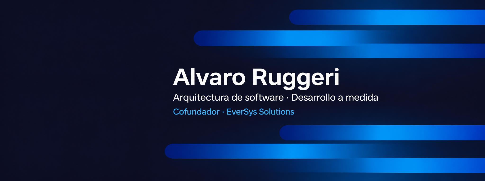

### Desarrollo de software · React · Next.js · TypeScript

Soy desarrollador de software y cofundador de **EverSys Solutions**, con base en Córdoba, Argentina. Trabajo junto al equipo en aplicaciones web, sistemas de gestión, automatizaciones e integraciones para empresas.

[LinkedIn](https://www.linkedin.com/in/alvaro-ruggeri/) · [EverSys Solutions](https://eversyssolutions.com.ar/)

## Tecnologías

**Frontend — foco principal**

  

**Backend, datos y colaboración**

  

  

## Cómo uso cada tecnología

Mi foco principal está en el frontend. En los proyectos de EverSys también colaboro con las integraciones y con aplicaciones que utilizan PHP, Laravel y MySQL. El stack cambia según el alcance y la base existente del proyecto.

### Interfaces y aplicaciones web

| Tecnología | Uso en el trabajo |
| --- | --- |
| **HTML** | Estructurar páginas, formularios y contenido con elementos semánticos. |
| **CSS** | Resolver layouts, adaptación a distintos tamaños de pantalla y estilos de interfaz. |
| **JavaScript** | Implementar interacciones, eventos, validaciones de interfaz y comunicación con APIs. |
| **TypeScript** | Explicitar los tipos de datos, las propiedades de componentes y las respuestas esperadas de las APIs para facilitar cambios y detectar incompatibilidades durante el desarrollo. |
| **React** | Construir componentes reutilizables y gestionar el estado de formularios, filtros y recorridos de usuario. |
| **Next.js** | Organizar rutas y páginas en aplicaciones React, trabajar con renderizado y carga de datos, y preparar sitios y aplicaciones para su despliegue. |
| **Tailwind CSS** | Aplicar estilos y variantes responsive de forma consistente dentro de los componentes. |
| **Bootstrap** | Construir interfaces y paneles administrativos en proyectos que ya utilizan su sistema de componentes y grilla. |

### Lógica de aplicación y datos

| Tecnología | Uso dentro de los proyectos del equipo |
| --- | --- |
| **PHP** | Trabajar con lógica del servidor en aplicaciones y sistemas de gestión basados en este lenguaje. |
| **Laravel** | Colaborar en aplicaciones que organizan rutas, validaciones, autenticación, permisos y operaciones sobre datos mediante el framework. |
| **MySQL** | Almacenar y relacionar información operativa, como productos, pedidos, clientes y estados, según el sistema. |

### Versionado y colaboración

| Herramienta | Uso en el trabajo |
| --- | --- |
| **Git** | Registrar cambios, trabajar con ramas y coordinar la integración del código del equipo. |
| **GitHub** | Compartir repositorios, revisar cambios mediante pull requests y mantener documentación junto al código. |

### Cómo se conectan

Una interfaz de React o Next.js presenta la información y recoge las acciones del usuario. Las integraciones comunican esas acciones con el servidor, que valida los datos y permisos antes de operar sobre la base de datos. Git y GitHub permiten seguir y revisar los cambios durante ese trabajo.

No todos los proyectos combinan estas tecnologías: algunos sistemas utilizan Laravel con Blade para las vistas; otros se apoyan en React y Next.js. Mantener la arquitectura existente y las necesidades del producto guía esa elección.

## Proyectos seleccionados

Desarrollados junto al equipo de EverSys Solutions.

| Proyecto | Alcance |
| --- | --- |
| [EverProp](https://github.com/maurocentu26/EverProp-Bellomo) | Plataforma inmobiliaria. Trabajo en desarrollo y revisión de recorridos de leads, asignación y permisos, en colaboración con el equipo. |
| Arcometal / EverShop | Comercio electrónico para Arcometal. Trabajo de desarrollo web en colaboración con el equipo. |
| Sabores del Norte | Aplicación de pedidos con catálogo administrable, carrito, checkout y seguimiento de estados. |
| Mogu Drinks | Carta digital, pedidos por WhatsApp y administración de productos, extras y promociones. |

**Mi aporte:** desarrollo frontend, interfaces responsive, integraciones y revisión de recorridos, según el alcance de cada proyecto. Los repositorios de clientes que no son públicos se mantienen privados.

## Forma de trabajo

Parto del proceso que necesita resolver el cliente, defino entregables con el equipo y participo en la implementación y revisión de los recorridos. En sistemas con roles, revisamos las operaciones permitidas y sus restricciones en el servidor, además de la interfaz.

## Contacto

Abierto a oportunidades de desarrollo web, frontend e integraciones. Trabajo en remoto; disponibilidad presencial únicamente en Córdoba, Argentina.

- **Perfil profesional:** [linkedin.com/in/alvaro-ruggeri](https://www.linkedin.com/in/alvaro-ruggeri/)
- **Proyectos y servicios:** [eversyssolutions.com.ar](https://eversyssolutions.com.ar/)
